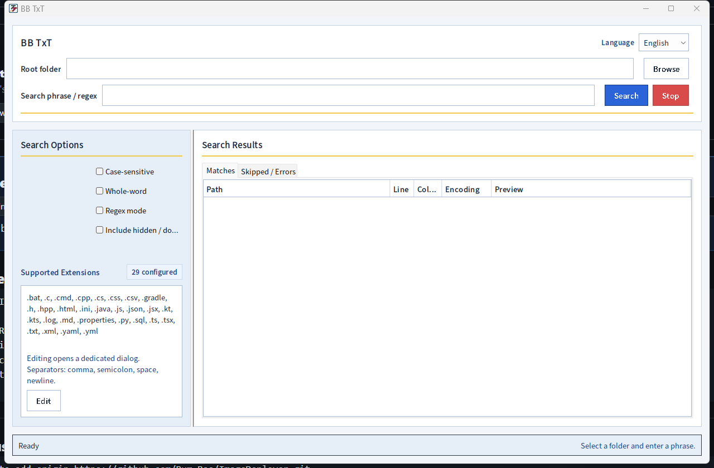
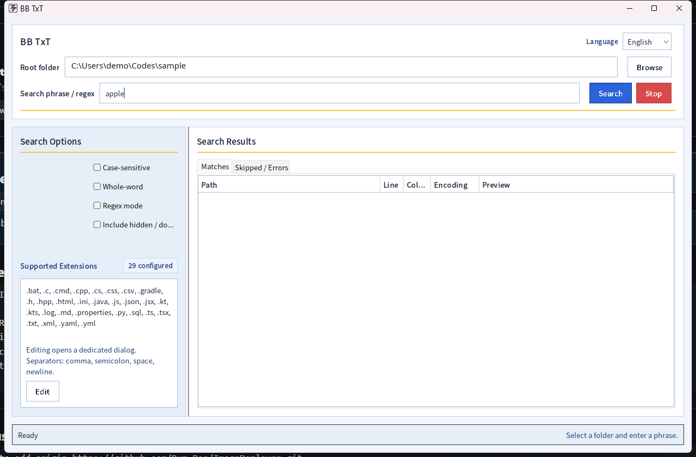
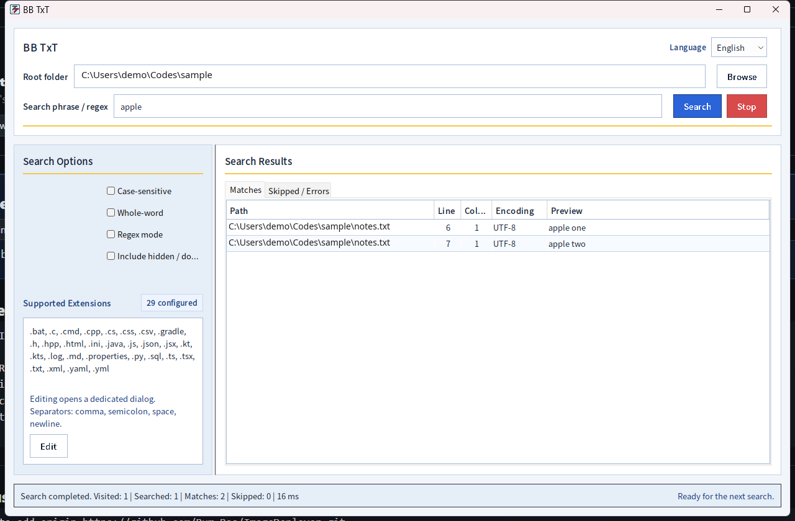

# BB TxT

> Fast local text search for source code, logs, configs, and readable text files.

[Overview](../../README.md) | [English](README.en.md) | [한국어](README.ko.md) | [中文](README.zh-CN.md) | [日本語](README.ja.md)

BB TxT is a Java Swing desktop app for developers who need fast, trustworthy text search across local source code, logs, configs, and other readable text files. If a file is in scope and readable, BB TxT searches it; if not, it reports what was skipped or why a read failed.

The product name is fixed as `BB TxT` across the app. Language switching changes localized UI strings, not the brand name.

## Key Features

- Recursive local folder scanning
- Literal search by default
- Case-sensitive, whole-word, and regex search modes
- Progressive result updates
- Explicit skipped/error reporting
- Hidden-file and extension filtering
- Stable multilingual UI rendering with a bundled Source Han Sans font set

## Supported Languages

- English
- Korean
- Japanese
- Chinese

## Current Release

The current repository version is `0.1.0`.

The first public release is distributed as the Windows app-image ZIP:

- `BB-TxT-app-image-0.1.0.zip`

Download the release artifact from GitHub Releases.

The Gradle build also supports a Windows installer-style EXE package. That path is supported by the build setup, but the current build machine still needs WiX Toolset installed before EXE packaging can be produced reliably.

## Local Development

Install JDK 17 first. The build uses a Java 17 toolchain and has no toolchain download repository configured,
so Gradle fails with "Cannot find a Java installation ... languageVersion=17" when only a newer JDK is installed.
On macOS or Linux, replace `.\gradlew.bat` with `./gradlew` in the commands below.

Run the app from the repository root:

```powershell
.\gradlew.bat run
```

Run the search verification and Swing smoke checks:

```powershell
.\gradlew.bat check
```

You can also run the checks individually:

```powershell
.\gradlew.bat runVerification
.\gradlew.bat runCorpusVerification
.\gradlew.bat runSmokeCheck
```

- `runVerification` checks the search engine on a small fixture.
- `runCorpusVerification` builds synthetic corpora for encodings (UTF-8, UTF-16, MS949/EUC-KR, BOMs), binary
  detection, very long lines, huge sparse files, symlinks, permission errors and ignore rules. Permission scenarios
  are skipped when the current user can read any file (for example root).
- `runSmokeCheck` opens the Swing window and also checks that restarting a search does not mix in stale results.
  It is skipped without a display; on a headless Linux machine run `xvfb-run -a ./gradlew check`.

GitHub Actions runs `check` on Ubuntu (under Xvfb) and Windows for every push and pull request
(`.github/workflows/ci.yml`).

## Performance

"Fast" here means interactive desktop speed, not command-line grep speed. Reproduce with:

```powershell
.\gradlew.bat runBenchmark
```

The task generates a seeded corpus in `build/bench-corpus` (20,000 files, 222 MiB: Java sources, UTF-8 and MS949
logs, JSON, Markdown, random binaries, one large log and one minified bundle) and times the search engine without
the Swing table. Measured on a 4-vCPU Linux cloud VM with JDK 17, warm file cache, median of 5 runs:

| Search | Median | Throughput |
|---|---|---|
| Literal, ASCII, case-insensitive | ~0.65 s | ~340 MiB/s |
| Literal, ASCII, case-sensitive | ~0.53 s | ~415 MiB/s |
| Literal, Korean | ~0.57 s | ~390 MiB/s |
| Literal, no matches | ~0.44 s | ~500 MiB/s |
| Regex, case-insensitive | ~0.8 s | ~280 MiB/s |

With a cold file cache a single search took about 1.5 s on the same corpus. For comparison, on the same machine
GNU grep 3.11 (`grep -rIic`) took about 0.14 s warm and 1.2 s cold, and ripgrep 14.1 about 0.05 s warm and 0.33 s
cold. Expect different numbers on other hardware, disks and antivirus setups (Windows Defender scanning in
particular was not measured).

## Build and Packaging

Build the packaging-ready jar:

```powershell
.\gradlew.bat jar
```

Build the Windows app-image:

```powershell
.\gradlew.bat packageAppImage
.\gradlew.bat releaseAppImageZip
```

Build the Windows installer EXE when WiX Toolset is available on the packaging machine:

```powershell
.\gradlew.bat packageExe
.\gradlew.bat releaseExe
```

Build the jar plus both release artifacts:

```powershell
.\gradlew.bat assembleRelease
```

Runtime Swing window icon:

- `src/main/resources/assets/icons/BTXTB.png`

Packaging icon for `jpackage`:

- `assets/icons/BTXTB.ico`

## Project Layout

```text
archive/legacy                 Archived legacy source
assets/icons                   Windows packaging icon
dist                           Local jpackage output
packaging                      Windows packaging notes
release                        Local release artifacts
src/main/java                  Application source
src/main/resources/assets/icons Runtime icon assets
src/main/resources/fonts       Bundled Source Han Sans fonts and license
src/main/resources/i18n        Localized UI strings
src/test/java                  Verification and smoke checks
sample-data                    Manual search fixtures
```

## Notes / Known Limitations

- BB TxT is focused on phase-1 developer text search; PDF and Office documents are not part of the core default flow.
- The app bundles Source Han Sans fonts to keep English, Korean, Japanese, and Chinese UI rendering stable.
- The Gradle packaging tasks are Windows-oriented.
- Encodings: UTF-8, UTF-16 with a BOM (or ASCII-heavy UTF-16 without one), and MS949/EUC-KR for `.txt`, `.log`,
  `.md`, `.properties`, `.csv`, `.ini`, `.bat` and `.cmd`. Other files that do not decode are listed as decode
  failures. Shift_JIS, GBK and Big5 text in those legacy extensions often decodes without errors as MS949; the file is
  then searched as garbled CJK, so CJK queries miss while ASCII queries still match. BOM-less UTF-16 text without ASCII characters is reported as binary.
- Binary detection only looks at the first 8 KiB of a file.
- Files without an extension (for example `Makefile`) cannot be included by the extension filter.
- Symbolic links inside the search folder are listed as skipped and never followed; a root folder that is itself a
  link is searched.
- Regex mode loads each file into memory and skips files larger than 2 GB. A file or a single line that does not fit
  into the Java heap is listed as too large instead of stopping the search.
- Release artifacts are meant to be uploaded to GitHub Releases, not committed into the source tree.
## Demo Walkthrough

The demo flow enters a folder path and a search term, then finds matching lines inside readable text files.

1. Launch the app.
2. Enter the root folder to search.
3. Enter a term such as `apple`.
4. Click `Search`.
5. Review the file name, line number, and matched text in the results table.

The first screen shows fields for the root folder, search term, and search options.



Enter the folder path and a keyword such as `apple`, then click the `Search` button in the top-right area.



After the search finishes, the results table shows the matched file path, line number, and text preview.


